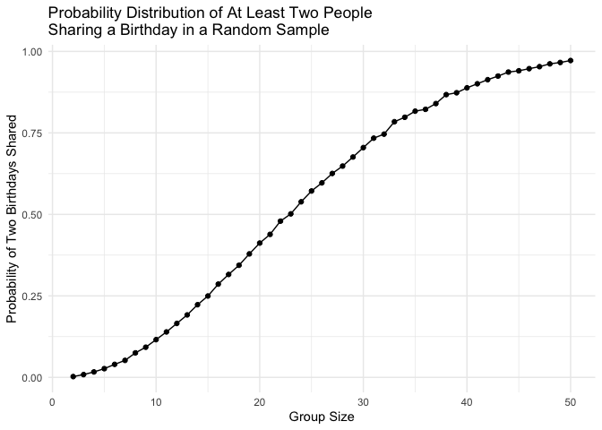
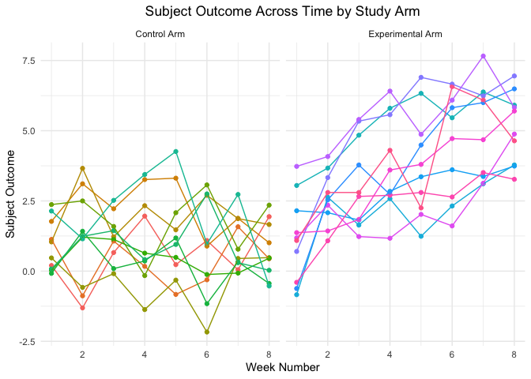
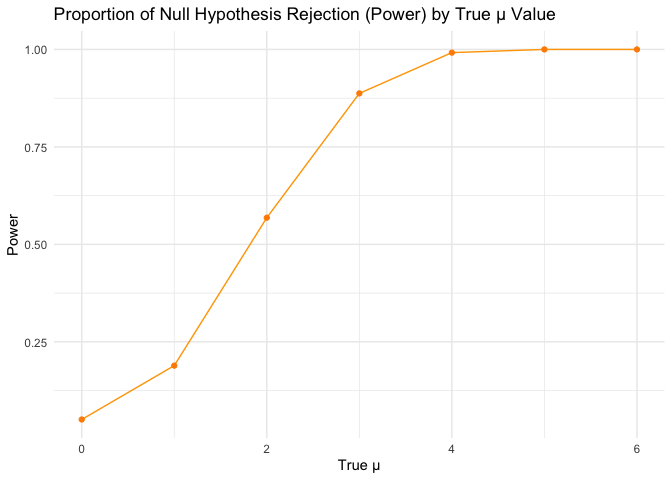
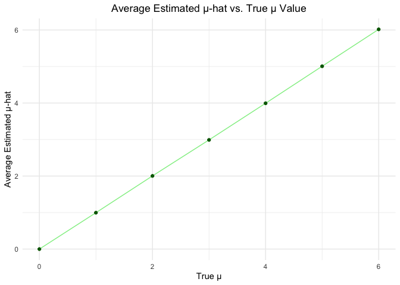
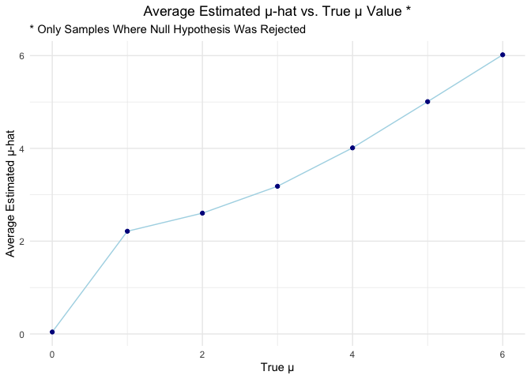
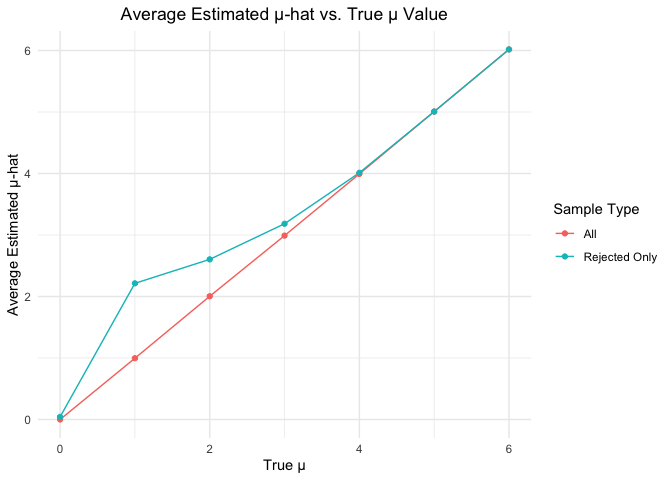

p8105_hw5_daq2107
================
Diego A. Quintana Licona
2026-11-19

## Loading necessary libraries for this assignment:

``` r
library(tidyverse) # For piping and ggplot
```

    ## ── Attaching core tidyverse packages ──────────────────────── tidyverse 2.0.0 ──
    ## ✔ dplyr     1.2.1     ✔ readr     2.2.0
    ## ✔ forcats   1.0.1     ✔ stringr   1.6.0
    ## ✔ ggplot2   4.0.3     ✔ tibble    3.3.1
    ## ✔ lubridate 1.9.5     ✔ tidyr     1.3.2
    ## ✔ purrr     1.2.2     
    ## ── Conflicts ────────────────────────────────────────── tidyverse_conflicts() ──
    ## ✖ dplyr::filter() masks stats::filter()
    ## ✖ dplyr::lag()    masks stats::lag()
    ## ℹ Use the conflicted package (<http://conflicted.r-lib.org/>) to force all conflicts to become errors

## Problem 1: Birthday Probability

For this problem, we are writing a function that, given a fixed number
of people, *n*, we can obtain the probability that at least two of those
people share a birthday. Note that we are assuming a uniform
distribution of birthday across the 365 days of the year, and we do not
consider leap years.

Instead of directly calculating the probability, we can make use of a
simulation for a group of *n* people where we randomly assign them a
birthday. In this case, instead of directly using dates, we can just use
the range 1:365 corresponding to the days of the year. For this we need
to also double check that our sampling allows for repeats, since we are
checking for the probability of duplicate birthdays. This is done with
the ‘replace’ parameter (see code below).

It is important to note that our old and reliable *rnorm()* function
does not work for this problem since we are not getting values from a
normal distribution, so I looked online at examples of how to take
random samples and saw the use of the *sample()* function here:

<https://pubs.wsb.wisc.edu/academics/analytics-using-r-2019/draw-a-random-sample.html>

From here we can write a function that helps us determine the birthday
duplicates, so we write a function that takes the parameter value of ‘n’
birthdays and then tells us if at least one of the birthdays appears
more than once. I found a useful post on Stack Overflow to check for
this and grabbed inspiration for my code:

<https://stackoverflow.com/questions/71083995/identifying-duplicates-in-a-list-of-character-vectors-in-r>

To summarize: the function takes the fixed group size, then randomly
generates a day out of 365 for each person, checks for duplication,
returns Boolean value:

``` r
# Taking my 'n' parameter, corresponding to the fixed amount of people in the room:

birthday_dupl = function(n) {
  
  # We first and foremost need to ensure the value entered is numeric,
  # so we can do a similar check as the one we covered during our Writing Functions lecture:
  
   if (!is.numeric(n)) {
    stop("Input must be numeric. Try again.")
   }
  
  # Now, we need to create a random sample for the birthdays given the range of the year.
  # We can use 'sample()' per the blog post I found using the range of 1-365 corresponding to the days of the year,
  # Moreover, we need to make sure we use 'replace = TRUE' in order to allow for potential duplicates:
  
  birth_sample = sample(1:365, size = n, replace = TRUE)
  
  # Based on the StackOverflow article above, I can use the 'duplicated()' function to check for any duplicated values.
  # Per the post, using 'any()' will return a Boolean TRUE or FALSE value:
  
  any_dupl = any(duplicated(birth_sample))
  
  # We can now just simply ask to return this Boolean:
  
  any_dupl
  
}

# Testing my function:

birthday_dupl(500)
```

    ## [1] TRUE

Voila! We have created the function to check if there are duplicate
birthdays in the fixed group. Now, to check for the actual probability,
we can use a similar approach like the one we covered in the
*Simulation* lecture, where we used the *expand_grid()* function to run
the 10,000 iterations specified in the assignment instructions. This
will be done for groups of sizes between 2-50 people, and we can then
use the function we just created above on each:

``` r
# Just like we did in lecture, we need to set the seed to make sure we are getting the same results:

set.seed(1)

# Using 'expand_grid()' just like we did for the Simulation lecture:

sim_bd = 
  expand_grid(
    group = 2:50, # Using the range provided in the instructions
    iter = 1:10000
  ) %>% 
  
  #For this I first tried using the 'map()' function we covered in lecture, but my plot was not working.
  #Then I did a quick Google search and saw that, for Boolean/logical values, I actually need to use the 'map_lgl()' function:
  
  mutate(
    dupl_map = map_lgl(group, birthday_dupl) #Using same approach to mapping as in lecture
  )

# Let's examine:

head(sim_bd, 5)
```

    ## # A tibble: 5 × 3
    ##   group  iter dupl_map
    ##   <int> <int> <lgl>   
    ## 1     2     1 FALSE   
    ## 2     2     2 FALSE   
    ## 3     2     3 FALSE   
    ## 4     2     4 FALSE   
    ## 5     2     5 FALSE

Now, from here, I can calculate the probability for each of the groups.
Luckily, the simulation above created a data frame where each row is an
iteration for a particular group size. Since we used the duplication
assessor function earlier, our simulation returns Boolean values to
denote if there is a duplicate or not. We can thus group by our group
sizes and just take the mean of the Boolean values across the iterations
to get our probability:

``` r
# Creating the data frame with grouped by group size:

birthday_groups = 
  sim_bd %>% # Using the data frame from the simulation we just ran
  group_by(group) %>% # Grouping by group sizes
  summarize(
    bd_prob = mean(dupl_map) #Obtaining the probability simply by getting the mean of the Boolean values
  )

# We can now create the plot of the probability distribution using our old and reliable 'ggplot':

birthday_groups %>% 
  ggplot(aes(x = group, y = bd_prob)) + 
  geom_line() + # Showing trend line
  geom_point() + # Putting all our points in scatter plot form
  theme_minimal() + #Using this like I did in Homework 4
  labs(
    title = "Probability Distribution of At Least Two People\nSharing a Birthday in a Random Sample",
    x = "Group Size",
    y = "Probability of Two Birthdays Shared"
  )
```

<!-- -->

**Plot Description:** As we can see from the plot above, the probability
that two people in the same room share the same birthday increases as
the group size (n) increases. It is important to note that the increase
is non-linear, and follows a somewhat sigmoidal shape. In the case of
very small groups, the probability is close to zero, and then increases
fast once the group size reaches around n = 10. We can see that the
probability is about 50% around when n = 25, and it becomes very close
to 100% once you reach 50 people.

## Problem 2: Analyzing Longitudinal Study Data

### Using Iteration to Load Our Data

For this problem, we can use a very similar approach like the one used
in the *Iterations and List Columns*. Just as the hint provided states,
we can make use of the *list.files()* function in order to read all of
our files at once, for both the experimental and the control arms of the
study.

Then, on the same pipe, I am also making use of the *purrr::map*
function, as hinted by the instructions, to iterate through each of the
names and be able to load our data at once:

``` r
# Using a very similar approach as the one covered in lecture.

# Saving my result as a new variable per the instructions, and using the 'purrr'
# package with the 'map' function:

full_long_names = 
  tibble(
    files = list.files("./HW5_Data/"),
    path = str_c("./HW5_Data/", files)
  ) %>%
  mutate(data = purrr::map(path, read_csv)
         ) %>% 
  unnest(data)
```

    ## Rows: 1 Columns: 8
    ## ── Column specification ────────────────────────────────────────────────────────
    ## Delimiter: ","
    ## dbl (8): week_1, week_2, week_3, week_4, week_5, week_6, week_7, week_8
    ## 
    ## ℹ Use `spec()` to retrieve the full column specification for this data.
    ## ℹ Specify the column types or set `show_col_types = FALSE` to quiet this message.
    ## Rows: 1 Columns: 8
    ## ── Column specification ────────────────────────────────────────────────────────
    ## Delimiter: ","
    ## dbl (8): week_1, week_2, week_3, week_4, week_5, week_6, week_7, week_8
    ## 
    ## ℹ Use `spec()` to retrieve the full column specification for this data.
    ## ℹ Specify the column types or set `show_col_types = FALSE` to quiet this message.
    ## Rows: 1 Columns: 8
    ## ── Column specification ────────────────────────────────────────────────────────
    ## Delimiter: ","
    ## dbl (8): week_1, week_2, week_3, week_4, week_5, week_6, week_7, week_8
    ## 
    ## ℹ Use `spec()` to retrieve the full column specification for this data.
    ## ℹ Specify the column types or set `show_col_types = FALSE` to quiet this message.
    ## Rows: 1 Columns: 8
    ## ── Column specification ────────────────────────────────────────────────────────
    ## Delimiter: ","
    ## dbl (8): week_1, week_2, week_3, week_4, week_5, week_6, week_7, week_8
    ## 
    ## ℹ Use `spec()` to retrieve the full column specification for this data.
    ## ℹ Specify the column types or set `show_col_types = FALSE` to quiet this message.
    ## Rows: 1 Columns: 8
    ## ── Column specification ────────────────────────────────────────────────────────
    ## Delimiter: ","
    ## dbl (8): week_1, week_2, week_3, week_4, week_5, week_6, week_7, week_8
    ## 
    ## ℹ Use `spec()` to retrieve the full column specification for this data.
    ## ℹ Specify the column types or set `show_col_types = FALSE` to quiet this message.
    ## Rows: 1 Columns: 8
    ## ── Column specification ────────────────────────────────────────────────────────
    ## Delimiter: ","
    ## dbl (8): week_1, week_2, week_3, week_4, week_5, week_6, week_7, week_8
    ## 
    ## ℹ Use `spec()` to retrieve the full column specification for this data.
    ## ℹ Specify the column types or set `show_col_types = FALSE` to quiet this message.
    ## Rows: 1 Columns: 8
    ## ── Column specification ────────────────────────────────────────────────────────
    ## Delimiter: ","
    ## dbl (8): week_1, week_2, week_3, week_4, week_5, week_6, week_7, week_8
    ## 
    ## ℹ Use `spec()` to retrieve the full column specification for this data.
    ## ℹ Specify the column types or set `show_col_types = FALSE` to quiet this message.
    ## Rows: 1 Columns: 8
    ## ── Column specification ────────────────────────────────────────────────────────
    ## Delimiter: ","
    ## dbl (8): week_1, week_2, week_3, week_4, week_5, week_6, week_7, week_8
    ## 
    ## ℹ Use `spec()` to retrieve the full column specification for this data.
    ## ℹ Specify the column types or set `show_col_types = FALSE` to quiet this message.
    ## Rows: 1 Columns: 8
    ## ── Column specification ────────────────────────────────────────────────────────
    ## Delimiter: ","
    ## dbl (8): week_1, week_2, week_3, week_4, week_5, week_6, week_7, week_8
    ## 
    ## ℹ Use `spec()` to retrieve the full column specification for this data.
    ## ℹ Specify the column types or set `show_col_types = FALSE` to quiet this message.
    ## Rows: 1 Columns: 8
    ## ── Column specification ────────────────────────────────────────────────────────
    ## Delimiter: ","
    ## dbl (8): week_1, week_2, week_3, week_4, week_5, week_6, week_7, week_8
    ## 
    ## ℹ Use `spec()` to retrieve the full column specification for this data.
    ## ℹ Specify the column types or set `show_col_types = FALSE` to quiet this message.
    ## Rows: 1 Columns: 8
    ## ── Column specification ────────────────────────────────────────────────────────
    ## Delimiter: ","
    ## dbl (8): week_1, week_2, week_3, week_4, week_5, week_6, week_7, week_8
    ## 
    ## ℹ Use `spec()` to retrieve the full column specification for this data.
    ## ℹ Specify the column types or set `show_col_types = FALSE` to quiet this message.
    ## Rows: 1 Columns: 8
    ## ── Column specification ────────────────────────────────────────────────────────
    ## Delimiter: ","
    ## dbl (8): week_1, week_2, week_3, week_4, week_5, week_6, week_7, week_8
    ## 
    ## ℹ Use `spec()` to retrieve the full column specification for this data.
    ## ℹ Specify the column types or set `show_col_types = FALSE` to quiet this message.
    ## Rows: 1 Columns: 8
    ## ── Column specification ────────────────────────────────────────────────────────
    ## Delimiter: ","
    ## dbl (8): week_1, week_2, week_3, week_4, week_5, week_6, week_7, week_8
    ## 
    ## ℹ Use `spec()` to retrieve the full column specification for this data.
    ## ℹ Specify the column types or set `show_col_types = FALSE` to quiet this message.
    ## Rows: 1 Columns: 8
    ## ── Column specification ────────────────────────────────────────────────────────
    ## Delimiter: ","
    ## dbl (8): week_1, week_2, week_3, week_4, week_5, week_6, week_7, week_8
    ## 
    ## ℹ Use `spec()` to retrieve the full column specification for this data.
    ## ℹ Specify the column types or set `show_col_types = FALSE` to quiet this message.
    ## Rows: 1 Columns: 8
    ## ── Column specification ────────────────────────────────────────────────────────
    ## Delimiter: ","
    ## dbl (8): week_1, week_2, week_3, week_4, week_5, week_6, week_7, week_8
    ## 
    ## ℹ Use `spec()` to retrieve the full column specification for this data.
    ## ℹ Specify the column types or set `show_col_types = FALSE` to quiet this message.
    ## Rows: 1 Columns: 8
    ## ── Column specification ────────────────────────────────────────────────────────
    ## Delimiter: ","
    ## dbl (8): week_1, week_2, week_3, week_4, week_5, week_6, week_7, week_8
    ## 
    ## ℹ Use `spec()` to retrieve the full column specification for this data.
    ## ℹ Specify the column types or set `show_col_types = FALSE` to quiet this message.
    ## Rows: 1 Columns: 8
    ## ── Column specification ────────────────────────────────────────────────────────
    ## Delimiter: ","
    ## dbl (8): week_1, week_2, week_3, week_4, week_5, week_6, week_7, week_8
    ## 
    ## ℹ Use `spec()` to retrieve the full column specification for this data.
    ## ℹ Specify the column types or set `show_col_types = FALSE` to quiet this message.
    ## Rows: 1 Columns: 8
    ## ── Column specification ────────────────────────────────────────────────────────
    ## Delimiter: ","
    ## dbl (8): week_1, week_2, week_3, week_4, week_5, week_6, week_7, week_8
    ## 
    ## ℹ Use `spec()` to retrieve the full column specification for this data.
    ## ℹ Specify the column types or set `show_col_types = FALSE` to quiet this message.
    ## Rows: 1 Columns: 8
    ## ── Column specification ────────────────────────────────────────────────────────
    ## Delimiter: ","
    ## dbl (8): week_1, week_2, week_3, week_4, week_5, week_6, week_7, week_8
    ## 
    ## ℹ Use `spec()` to retrieve the full column specification for this data.
    ## ℹ Specify the column types or set `show_col_types = FALSE` to quiet this message.
    ## Rows: 1 Columns: 8
    ## ── Column specification ────────────────────────────────────────────────────────
    ## Delimiter: ","
    ## dbl (8): week_1, week_2, week_3, week_4, week_5, week_6, week_7, week_8
    ## 
    ## ℹ Use `spec()` to retrieve the full column specification for this data.
    ## ℹ Specify the column types or set `show_col_types = FALSE` to quiet this message.

``` r
# Inspecting the data frame:

head(full_long_names, 5)
```

    ## # A tibble: 5 × 10
    ##   files      path        week_1 week_2 week_3 week_4 week_5 week_6 week_7 week_8
    ##   <chr>      <chr>        <dbl>  <dbl>  <dbl>  <dbl>  <dbl>  <dbl>  <dbl>  <dbl>
    ## 1 con_01.csv ./HW5_Data…   0.2   -1.31   0.66   1.96   0.23   1.09   0.05   1.94
    ## 2 con_02.csv ./HW5_Data…   1.13  -0.88   1.07   0.17  -0.83  -0.31   1.58   0.44
    ## 3 con_03.csv ./HW5_Data…   1.77   3.11   2.22   3.26   3.31   0.89   1.88   1.01
    ## 4 con_04.csv ./HW5_Data…   1.04   3.66   1.22   2.33   1.47   2.7    1.87   1.66
    ## 5 con_05.csv ./HW5_Data…   0.47  -0.58  -0.09  -1.37  -0.32  -2.17   0.45   0.48

``` r
names(full_long_names)
```

    ##  [1] "files"  "path"   "week_1" "week_2" "week_3" "week_4" "week_5" "week_6"
    ##  [9] "week_7" "week_8"

### Tidying our Data

Great! Now we can proceed to tidy our data. Following the examples
covered in the *Iteration and List Columns*, we notice that some
important variables are contained within others, such as the name, which
includes the type of study group (i.e., control or experiment), and the
subject ID number.

Moreover, we see that our data is panel data, where each weekly
observation is saved in wide format, with each week being a separate
column. This is hard to manage. Thus, we can use our old and reliable
*pivot_longer()* function to grab all weekly observations and put them
in long format, and that way, our tidy data frame should contain the
study group, the week, the subject ID, and what the outcome was.

``` r
# Creating a new tidy data frame for my longitudinal data:

tidy_long_df =
  full_long_names %>% 
  # We can clean variable names just like we have done in previous asssignments using the janitor package:
  janitor::clean_names() %>% 
  
  # From here, we can use a similar approach as the one done in lecture and make use of the 'str_replace'
  # function to remove the '.csv' name from the files column in our data frame:
  mutate(
    files = str_replace(files, ".csv", ""),
    group = str_sub(files, 1, 3) # Grabbing only the first three characters of name
  ) %>% 
  
  # Now we need to change our data from the 'wide' format to 'long' format using our well-known
  # 'pivot_longer()' function:
  
  pivot_longer(
    week_1:week_8, # Grabbing the number of weeks included in the df
    names_to = "week",
    values_to = "outcome",
    names_prefix = "week_"
  ) %>% 
  # Had issues in steps below with the data analysis for the spaghetti chart and it was because weeks 
  # was detected as a string rather than a numeric value, so mutating here:
  
  mutate(week = as.numeric(week)) %>% 
  
  # We can now use 'select()' in order to keep the variables we need
  # for this assignment:
  
  select(group, subject = files, week, outcome)
  
# Visualizing the tidy data frame:

head(tidy_long_df, 5)
```

    ## # A tibble: 5 × 4
    ##   group subject  week outcome
    ##   <chr> <chr>   <dbl>   <dbl>
    ## 1 con   con_01      1    0.2 
    ## 2 con   con_01      2   -1.31
    ## 3 con   con_01      3    0.66
    ## 4 con   con_01      4    1.96
    ## 5 con   con_01      5    0.23

### Plotting Subjects Over Time

Now that we have our data tidied, we can proceed to create an
*spaghetti* plot (using ggplot), which is simply a plot to visualize
outcomes across time where each line represents a different participant.
We will make use of *geom_path()* to connect observations for the same
subject. This, combined with study branch, will allow us to look at
differences for each individual participant and also across study arms.
Moreover, I am also using *theme_minimal()* for better aesthetics, just
like I did in the last couple of homeworks.

Since we are looking at the data per study group (i.e., control or
experiment), we need to facet by the *group* variable in our data frame.

``` r
# Creating the spaguetti plot from the tidy data frame created above:

tidy_long_df %>% 
  
  # Making use of case match to make sure my study arms are appropriately labeled.
  # Same process as in previous homeworks:
  
  mutate(
    group = case_match(
      group,
      "con" ~ "Control Arm",
      "exp" ~ "Experimental Arm"
    )
  ) %>% 
  
  # We use the 'subject' variable we created above 
  
  ggplot(aes(x = week, y = outcome, group = subject, color = subject)) + 
  geom_point() +
  geom_path() + 
  facet_grid (. ~ group) + 
  theme_minimal() +
  theme(legend.position = "none", # Removing the subject legends
        plot.title = element_text(hjust = 0.5)) + # Centering the title
  labs(
    title = "Subject Outcome Across Time by Study Arm",
    x = "Week Number",
    y = "Subject Outcome"
  )
```

    ## Warning: There was 1 warning in `mutate()`.
    ## ℹ In argument: `group = case_match(group, "con" ~ "Control Arm", "exp" ~
    ##   "Experimental Arm")`.
    ## Caused by warning:
    ## ! `case_match()` was deprecated in dplyr 1.2.0.
    ## ℹ Please use `recode_values()` instead.

<!-- -->

**Describing the Plot:** As we can see from the trend above, the study
subjects in the control arm have highly variable outcomes across the
eight weeks of the study duration, with a minimum value of -2.17 and a
maximum value of 4.26. Despite this high variability, there is no clear
increasing or decreasing trend in the study outcome during the duration
of the study.

On the other hand, the participants in the experimental arm of the study
display an increasing trend in the study outcome across the eight weeks
of the study. The maximum outcome value in this arm at Week 8 was 6.95,
which is 4.6 units higher than the highest value in the control arm at
Week 8.

Overall, based on this data, I would suggest that there is a clear
difference in outcome trends between both study arms, with the
experimental arm showing a consistent increasing trend across time. We
then may have preliminary evidence to determine a potential association
between the treatment and outcome of interest, but not yet able to
determine full causality.

## Problem 3: Analyzing Power Using Simulation

### Creating a Function for Simulation

For this problem, we can use a very similar approach to the one utilized
for Problem 1, where we create a function to run a t-test given a
changeable value for *μ* and fixed values for both *σ* and *n*. This is
very similar to the example we covered in our *Simulation* lecture. The
main difference compared with Problem 1 is that, in this case, we *do*
make use of our old and reliable *rnorm()* function:

``` r
# Creating a function to run our simulation, where our input parameter
# will be the value of mu. Note that, per the instructions, we are fixing
# the values for our 'n' to be 30, and our 'sigma' to be 5:

sim_p3 = function(mu_value, n = 30, sigma = 5) {
  
  # We can now generate our random sample with our fixed number of observations and sigma:
  
  sim_data = tibble(
     x = rnorm(n, mean = mu_value, sd = sigma)
  )
  
  # Now, per the hint provided, we can just run a t-test to assess the null
  # hypothesis that the true mu = 0.
  
  # Notice that for the t-test we are not using the whole tibble but just the
  # x value we created above for the simulation data:
    
  t_test = t.test(sim_data$x, mu = 0) %>% 
    broom::tidy()  # Cleaning our results, per assignment hint
  
# Now, per the assignment instructions, we are also asked to keep the sample mu and p-value.
# Recall we obtained the estimate and the p-value from the broom::tidy step above:
    
  t_test %>% 
    select(sample_mu = estimate, p_value = p.value)
  
}

# Let's now test our function with μ = 0:

set.seed(1) # Setting seed so results are reproducible

sim_p3(0)
```

    ## # A tibble: 1 × 2
    ##   sample_mu p_value
    ##       <dbl>   <dbl>
    ## 1     0.412   0.629

### Creating a Data Frame from Multiple True μ

We have now created a function utilizing the parameters established, and
we can now vary the value μ. Now, per the assignment instructions, we
can run 5000 iterations for when μ = 0, and then repeat this procedure
for μ = {1, 2, 3, 4, 5, 6}.

To do this, we can use a very similar approach to what we did in Problem
1 and following the *Simulation* lecture notes. We first start with the
*expand_grid()* function, just like above, and we do 5,000 iterations
for each value of μ. We then use the *purrr::map* function again and we
can just simply apply the function we just created above to each
simulation. We can thus obtain a data frame where we will list the
inputted (true) μ, the sample’s μ and the p-value:

``` r
# Setting seed before starting to allow for reproducibility:

set.seed(1)

# Just like in problem 1, we can create a data frame for the results of our
# simulation, for all μ values of interest:

sim_p3_results =
  expand_grid(
    mu_value = 0:6, # The values of μ we want to check
    iter = 1:5000 #Iterating 5000 times
  ) %>% 
  mutate(
    estimate_df = map(mu_value, sim_p3) # Using the function we created above
  ) %>% 
  unnest(estimate_df)

# Let's visualize our data frame:

head(sim_p3_results, 5)
```

    ## # A tibble: 5 × 4
    ##   mu_value  iter sample_mu p_value
    ##      <int> <int>     <dbl>   <dbl>
    ## 1        0     1     0.412  0.629 
    ## 2        0     2     0.664  0.368 
    ## 3        0     3     0.551  0.534 
    ## 4        0     4     0.567  0.487 
    ## 5        0     5    -1.65   0.0599

``` r
# Looking good!
```

### Visualizing Power

Now that we have run the needed simulations, we can make a plot showing
the proportion of times the null was rejected against the different true
values of μ we included. In this case, let us consider the null
hypothesis to be:

H_0: μ = 0, with α = 0.05

First, we need to calculate the proportion of time the null was rejected
or, in other words, the power of the test. We can do this by creating a
variable where we check if the saved p_values for each iteration are
below our significance level (α = 0.05), which would allow us to reject
the null. Then, we can just simply group the results of our simulation
(using *group_by()*) by each true value of μ and calculate the mean of
the rejection value just created:

``` r
# Creating a new logical variable in our simulation data frame:

sim_p3_reject =
  sim_p3_results %>% 
  mutate(
    reject = (p_value < 0.05) # this would yield either TRUE or FALSE
  ) %>% 
  group_by(mu_value) %>% # We can now group by our true μ values
  summarize(
    reject_prop = mean(reject)
  )

# We can now just make use of ggplot in order to create our plot:

sim_p3_reject %>% 
  ggplot(aes(x = mu_value, y = reject_prop)) + 
  geom_line(color = "orange") + 
  geom_point(color = "darkorange") +
  theme_minimal() +
  theme(plot.title = element_text(hjust = 0.5)) + # Centering the title
  labs(
    title = "Proportion of Null Hypothesis Rejection (Power) by True μ Value",
    x = "True μ",
    y = "Power",
  )
```

<!-- -->

**Describing the Association:** From the figure above, we can see that
there is a clear positive association between the effect size (the true
value of μ) and power (the proportion of times the null hypothesis gets
rejected).

The more that the true population mean moves away from zero, the
proportion of null hypothesis being rejected increases. We can see this
relationship is sigmoidal, and about when true μ = 4, the proportion of
all rejected null hypothesis becomes extremely close to 1 (but just
below it). Similarly, when true μ = 0, the null hypothesis is true, so
at this observation, the probability of rejecting the null hypothesis
equals the Type I error rate. Thus, the value on the y-axis is the Type
I error value.

### The Fight Between Estimated μ̂ and True μ

Now, let’s create another plot showing the average estimate of μ̂ against
the true value of μ. To do this, we can take a similar approach like the
one we did above, grouping by the true μ value and then, since we
already have a *sample_mu* variable, we can simply find the mean of it
using *summarize()*. Then, we can just create the plot using ggplot:

``` r
p3_plot_2 =
  sim_p3_results %>% 
  group_by(mu_value) %>% 
  summarize(
    mean_sample_mu = mean(sample_mu) # getting our average values
  ) %>% 
  ggplot(aes(x = mu_value, y = mean_sample_mu)) + 
  geom_line(color = "lightgreen") + 
  geom_point(color = "darkgreen") +
  theme_minimal() +
  theme(plot.title = element_text(hjust = 0.5)) + # Centering the title
  labs(
    title = "Average Estimated μ-hat vs. True μ Value",
    x = "True μ",
    y = "Average Estimated μ-hat",
  )

# Now let's visualize the plot:

p3_plot_2
```

<!-- -->

Now, we can make a second plot following the same process as above, but
only for the samples in which we rejected the null. We can thus use an
almost identical approach as to how the *sim_p3_reject* data frame was
created above, since this data frame contains a variable assessing if we
can reject the null hypothesis:

``` r
p3_plot_3 =
  sim_p3_results %>% 
  filter(p_value < 0.05) %>%  # keeping only samples where null was rejected
  group_by(mu_value) %>% 
  summarize(
    mean_sample_mu = mean(sample_mu) # getting our averages
  ) %>% 
  ggplot(aes(x = mu_value, y = mean_sample_mu)) + 
  geom_line(color = "lightblue") + 
  geom_point(color = "darkblue") +
  theme_minimal() +
  theme(plot.title = element_text(hjust = 0.5)) + # Centering the title
  labs(
    title = "Average Estimated μ-hat vs. True μ Value *",
    subtitle = "* Only Samples Where Null Hypothesis Was Rejected",
    x = "True μ",
    y = "Average Estimated μ-hat",
  )

# Now let's visualize the plot:

p3_plot_3
```

<!-- -->

To better visualize the contrast between these two plots, let’s create
an overlaid plot. We can make use of most of the code already written
above:

``` r
# Using same pipe process as first plot:

df_plot2 =
  sim_p3_results %>% 
  group_by(mu_value) %>% 
  summarize(
    mean_sample_mu = mean(sample_mu) # getting our average values
  ) %>% 
  mutate(
    which_plot = "All" # Creating identifying variable
  )

# Using same pipe process as second plot:

df_plot3 = 
  sim_p3_results %>% 
  filter(p_value < 0.05) %>%  # keeping only samples where null was rejected
  group_by(mu_value) %>% 
  summarize(
    mean_sample_mu = mean(sample_mu) # getting our averages
  ) %>%
  mutate(
    which_plot = "Rejected Only" # Creating identifying variable
  )

# Merging my data frames:

df_plot4 =
  bind_rows(df_plot2, df_plot3)

# And now making my overlapped plot, again, using same structure as plots above:

p3_plot_4 =
  df_plot4 %>% 
  ggplot(aes(x = mu_value, y = mean_sample_mu, color = which_plot)) + 
  geom_line() + 
  geom_point() +
  theme_minimal() +
  theme(plot.title = element_text(hjust = 0.5)) + # Centering the title
  labs(
    title = "Average Estimated μ-hat vs. True μ Value",
    x = "True μ",
    y = "Average Estimated μ-hat",
    color = "Sample Type"
  )

# Now let's visualize the plot:

p3_plot_4
```

<!-- -->

**Plots Description & Question Answer:** The sample average of μ-hat
across tests for which the null is rejected is only approximately equal
to the true value of μ when the true μ is relatively large (μ = {4, 5,
6}), and when the true μ = 0.

As we can see from the three plots above, when considering all the
samples, the values for the estimated μ-hat almost perfectly align with
the values of the true μ. This result, while interesting, also makes
sense since, when we average all 5,000 simulated samples, for each value
of μ — and just like we saw in our *Simulation* lecture — the sample
mean estimates are expected to be more centered around the true
population mean. Also note that, when true μ = 0, the average estimated
mean for the rejected samples is also zero since this test is two-sided
test and, when taking thousands of simulated samples, the samples that
reject and fail to reject the null balance/cancel each other out.

Moreover, we can see that when we only take the samples for which we
reject the null hypothesis, the average estimated μ-hat deviates from
the true μ values, in particular when μ = {1, 2, 3}. This also makes
sense, and it is actually in agreement with what we observed in our
Power vs. μ graph: when we have low power, only samples with extreme
estimated μ-hat values will be able to yield a p-value that is below the
0.05 significance threshold. However, as we increase in our true μ
values, power (the probability of rejecting a false null hypothesis)
also increases, and thus a greater proportion of the simulated samples
will reject the null hypothesis, making the all-samples set and the
rejects-only set very similar.

Per the explanation above, we can see that in both the power vs. true
effect and in the average estimated μ vs. true μ graphs, it is around
true μ = 4 when we lose distinction between the rejected-only averages
and the all-sample averages.

## The End :) Have a wonderful day!
